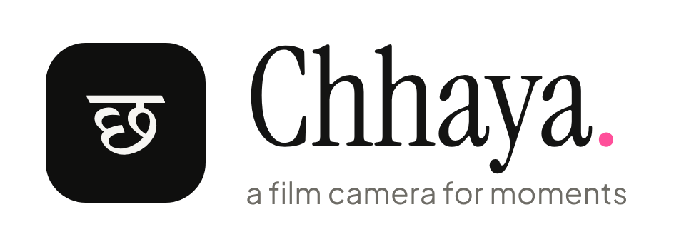
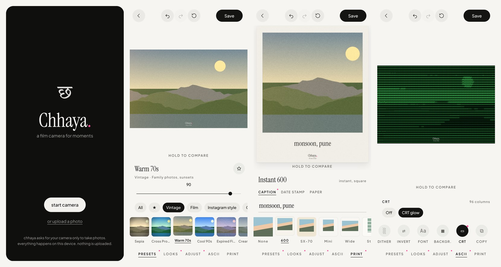
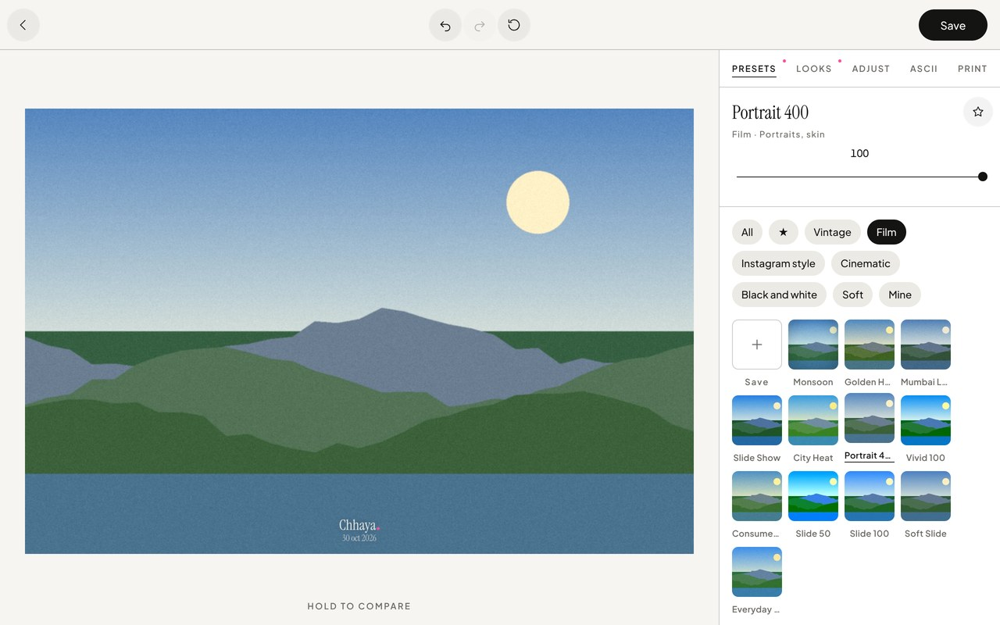
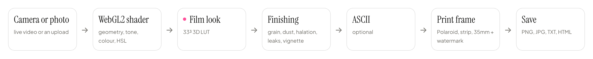

<p align="center">
  <picture>
    <source media="(prefers-color-scheme: dark)" srcset="docs/assets/logo-dark.png">
    
  </picture>
</p>

<p align="center">
  <a href="https://chhaya-two.vercel.app"><strong>Open the app</strong></a> ·
  <a href="docs/plan.md">Product plan</a> ·
  <a href="CHANGELOG.md">Changelog</a> ·
  <a href="CREDITS.md">Credits</a>
</p>

<p align="center">
  <a href="LICENSE"></a>
  
  
  
</p>

**Chhaya** (छाया, "shadow, image" in Marathi) is a camera booth on the web. Shoot film-look photos, turn them into ASCII art, and print them as Polaroids and photo strips. Everything runs in your browser: no sign-in, no uploads.

<p align="center">
  
</p>

## Features

**Shoot**
- Live viewfinder with the look already applied. Swipe to change looks.
- Photo, Strip and live ASCII modes, with a camera toolbar:
  - **Grid:** 12 photo-booth layouts from 2 to 6 shots (strips, side by side, 2×2, 3×2).
  - **Filter:** pick any look by family.
  - **Light:** turns the screen into a ring light in 15 colours (warm, skin-flattering tones and fun ones), plus any custom colour and a brightness slider. The flash uses the same colour.
  - **Timer:** Off, 3s, 5s or 10s.
- Flash, front/back camera, mirror on/off. Full-resolution stills where the browser supports it.
- Upload or drag and drop instead of shooting.

**Looks and presets**
- 125 looks: 40 hand-tuned film looks plus 85 recipe looks (Instagram style, vintage, film stocks, black and white, cinematic, soft). Strength 0–12.
- 101 presets in six categories, with a 0–100 intensity slider, ★ favourites and saving your own.
- Import your own LUTs: `.cube` or HaldCLUT `.png`.

**Edit**
- 24 tools in six groups:
  - Light: exposure, contrast, highlights, shadows, whites/blacks.
  - Colour: temperature, tint, saturation, vibrance, skin tone, HSL (8 colours), split tone.
  - Detail: clarity, texture, sharpness, dehaze.
  - Film: grain (amount, size, roughness), fade, dust, halation, light leaks.
  - Effects: vignette, blur and tilt-shift.
  - Crop: 8 ratios, rotate, flip, straighten.
- Hold the photo to compare, plus undo and redo.

**ASCII**
- 8 character sets, including braille, blocks, matrix and moon phases. 40–240 columns.
- 7 colour styles, edge lines, and 4 dithering modes (including Floyd–Steinberg and Atkinson).
- 4 fonts, any background, and a CRT glow.
- Export as PNG, TXT or HTML, or copy the text.

**Print**
- Instant 600, SX-70, Mini, Wide, 35mm film, plain border and all 12 photo-booth grids (a single photo is repeated into each cell).
- Caption, orange date stamp, paper texture, and a develop-from-white animation.
- Every photo carries a small "Chhaya." watermark that switches between light and dark ink to suit the photo.

**Save**
- PNG or JPG through the same GPU pipeline as the preview, at least 3000px on the long side so text and the watermark stay sharp when zoomed. Prints are capped at 14 MP so phones can save them.
- Share sheet on phones.

<p align="center">
  
</p>

## Quick start

```bash
npm install
npm run dev
```

Open http://localhost:3000. The camera needs `localhost` or HTTPS. Other scripts: `npm run build`, `npm start`, `npm run typecheck`.

Deploys to Vercel with no settings: `vercel.json` pins the Next.js preset.

## How it works

<p align="center">
  <picture>
    <source media="(prefers-color-scheme: dark)" srcset="docs/assets/pipeline-dark.png">
    
  </picture>
</p>

- One shader pass does the whole edit. The live viewfinder, preview, thumbnails and export all use it, so they always match. Blurs (clarity, halation, tilt-shift) read the source's mipmaps, so it stays live on phones.
- Every look ends up as a 33³ LUT. Hand-tuned looks are colour settings, recipe looks are short lists of colour steps, and imported LUTs are resampled. All three render the same way.
- ASCII and print frames are drawn on a 2D canvas after the GPU pass.

## Project structure

```
src/
  app/                   Next.js app: layout, page, global styles, icons
  chhaya/
    Chhaya.tsx           screens: intro → camera → develop
    components/          Camera, Develop, Adjust/ASCII/Print panels, slider, icons
    gl/                  WebGL2 renderer and shaders
    data/
      recipe-looks.json  85 recipe looks (one entry per look)
      presets.json       101 presets (one entry per preset)
    looks.ts             the 40 hand-tuned looks and LUT baking
    recipes.ts           recipe steps: CSS filters, blend modes, colour matrix
    presets.ts           categories, intensity blending, favourites
    lut-import.ts        .cube and HaldCLUT import
    edit.ts              the edit model and the 24 tools
    ascii.ts             photo → characters
    frames.ts            prints and the watermark
docs/                    product plan, filter guide, logo and screenshots
```

## Add a look or preset

Looks and presets are data, so adding one means adding one JSON entry.

A recipe look in `src/chhaya/data/recipe-looks.json`:

```json
{
  "code": "V14", "name": "Monsoon Fade", "family": "Vintage",
  "inspiredBy": "rainy-day prints", "character": "Cool, soft, faded",
  "recipe": [["css-contrast", 0.9], ["rgb", 0.95, 1.0, 1.06], ["add", 18, 20, 24]],
  "grain": 0.2, "grainSize": 1, "halation": 0, "vignette": 0.1,
  "source": "Chhaya (own recipe)"
}
```

A preset in `src/chhaya/data/presets.json`:

```json
{
  "id": "monsoon-fade", "name": "Monsoon Fade", "category": "Vintage",
  "goodFor": "Rainy streets", "intensity": 90,
  "edit": { "look": "v14", "grain": 15, "dust": 10 }
}
```

The recipe steps are listed in `src/chhaya/recipes.ts`. Categories are Vintage, Film, Instagram style, Cinematic, Black and white and Soft.

## Import a LUT

In the editor, open **Looks** and tap **+ LUT**. Pick a `.cube` file (any size) or a HaldCLUT `.png`. The LUT becomes a look and a preset under **Mine**, and it's saved in your browser. Check the license of any LUT pack before you share images made with it.

## Privacy

Photos are processed in your browser and never uploaded. The camera is only requested when you tap "start camera". Presets, favourites and imported LUTs are stored in your browser's local storage on that device.

## Fonts

The design uses **Cirka** (display) and **Gilroy** (UI). Until their files are added to `public/fonts` (see `src/app/globals.css`), the app uses Instrument Serif and Plus Jakarta Sans, with Tiro Devanagari Marathi for छ. All fonts are self-hosted at build time by `next/font`.

## Roadmap

- Tone curve editor
- ASCII GIF loop
- Studio gallery of past shots
- Preset from a before/after photo pair
- Sounds and haptics polish

## Contributing

Issues and pull requests are welcome. Keep looks and presets as data. Credit any reused values in `CREDITS.md`, and only reuse values from openly licensed sources.

## License

[MIT](LICENSE) © 2026 Yog Urkundwar. Values reused from other open source projects are credited in [CREDITS.md](CREDITS.md).
